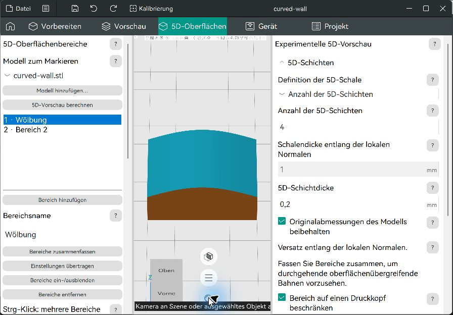
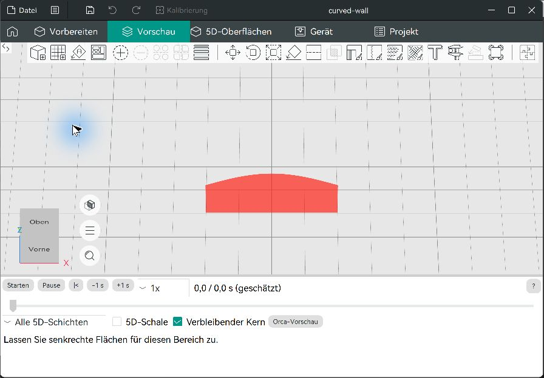
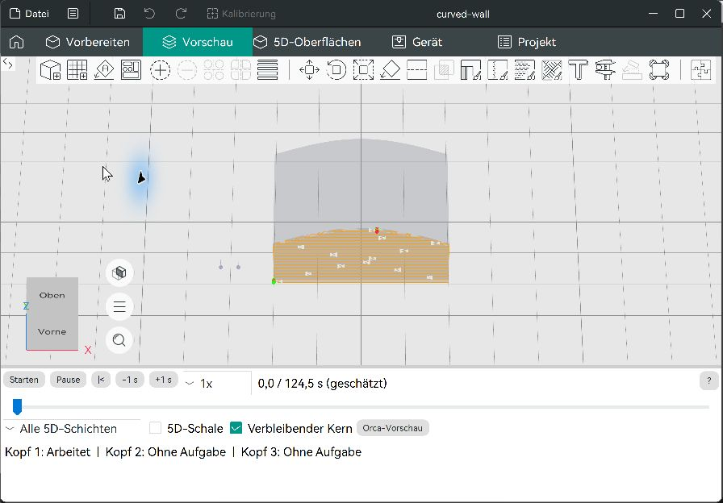
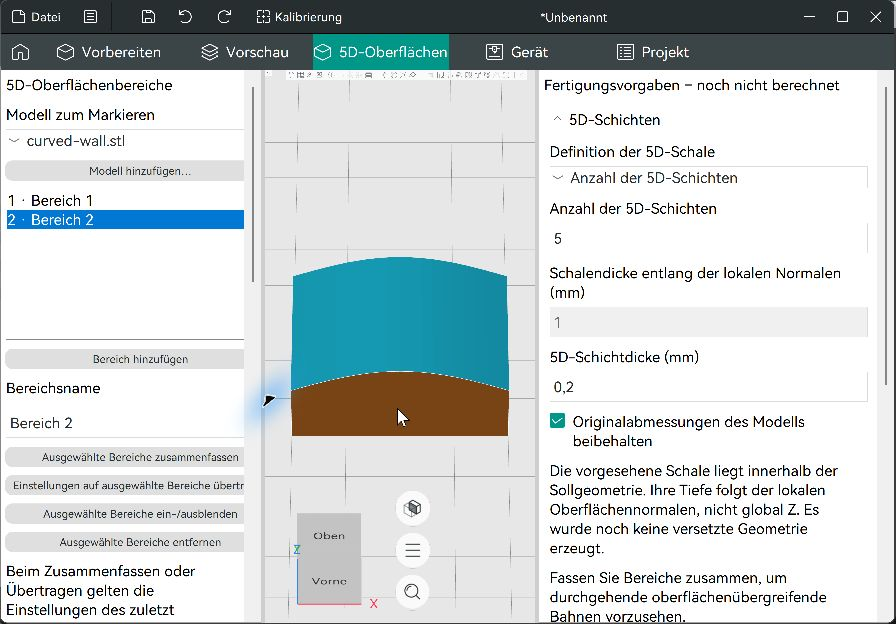

# Demonstration der nichtplanaren Vorschau

Das Beispiel [curved-wall.3mf](examples/curved-wall.3mf) ist ein synthetischer geschlossener Körper mit einer gewölbten Oberseite und einer senkrechten Vorderwand. Es enthält zwei tatsächlich markierte Bereiche und ihre Einstellungen. Die Screenshots stammen aus dem Windows-Release-Build; es sind keine Entwürfe.

## Wölbung und Zeitleiste

1. Die 3MF **als Projekt öffnen**, damit Profile, Markierungen und Formorix-Einstellungen übernommen werden.
2. **5D-Oberflächen** öffnen und **Wölbung** auswählen. Die gespeicherten Werte sind vier Lagen mit 0,2 mm Schichtdicke; Kopf 1 ist zugeordnet. Bei Bedarf die vorhandene Funktion **Kamera an Szene oder ausgewähltes Objekt anpassen** verwenden.
3. **5D-Vorschau berechnen** wählen. Die Vorschau öffnet sich mit vier nichtplanaren Lagen und drei nummerierten Düsenspitzen. Nur Kopf 1 hat eine berechnete Bahn; die beiden grauen Düsen haben noch keine Aufgabe.
4. Den horizontalen Zeitschieber ungefähr in die Mitte ziehen. Die Düsenspitze bewegt sich zur entsprechenden TCP-Pose. Start/Pause, ±1 s und die Wiedergabegeschwindigkeit wirken auf dieselbe Prozesszeit.
5. Eine einzelne Lage auswählen und **5D-Schale** beziehungsweise **Verbleibender Kern** einblenden. Die Lagenwahl verändert nicht die aktuelle Zeit.
6. Mit **Orca-Vorschau** zur normalen Vorschau wechseln. Das experimentelle Formorix-Profil erlaubt weiterhin keinen ausführbaren Druckauftrag. Für konventionelles Drucken muss ein normales Druckerprofil verwendet werden.

Nach Neustart wieder geladener Editor:



Bei der Live-Prüfung wurde die Wölbung auf 108,3 s gestellt und anschliessend per Start/Pause bis 120,3 s abgespielt. Die Düsenspitze und die grüne Fortschrittsdarstellung änderten sich entsprechend. Auch die zweite Lage und die Kernanzeige wurden geprüft. Die untenstehende Aufnahme dokumentiert die gleiche Vorschauoberfläche am separaten Wandbereich; die später hinzugefügten Nummernschilder der Düsen und die ausgeblendete Werkzeugleiste sind darin noch nicht enthalten.

## Senkrechte Wand

**Bereich 2** ist die senkrechte Vorderwand. Im gespeicherten Beispiel sind **Senkrechte Flächen zulassen** und **Abweichung von der Oberflächennormalen** aktiviert; die maximale Abweichung beträgt 15°. Diese Kombination ergibt bei der konfigurierten maximalen Neigung von 75° eine Vorschau. Sie belegt keine tatsächliche Erreichbarkeit der Maschine.

Wird die Freigabe für senkrechte Flächen deaktiviert und erneut berechnet, erscheinen die Wand rot und ein kurzer Hinweis:



Mit den beiden Freigaben:



Die vorherige Oberfläche ohne Bahnplanung ist zum Vergleich dokumentiert:



## Automatisierte Reproduktion

Nach einem Release-Build mit aktivierten Tests:

```powershell
.\build\tests\libslic3r\Release\libslic3r_tests.exe '[FormorixPreview]'
ctest --test-dir build -C Release --output-on-failure -LE 'NotWorking|RequiresApp' -j 2
```

Die Testquelle erzeugt zusätzlich geneigte, konvexe, konkave, zusammengefasste, enge und Hydrofoil-Geometrien sowie drei unabhängige Zeitsignale. [Prüfergebnisse](verification/summary.json), [Grenzen und Abnahmebericht](../Formorix-Auftrag-03.md).
