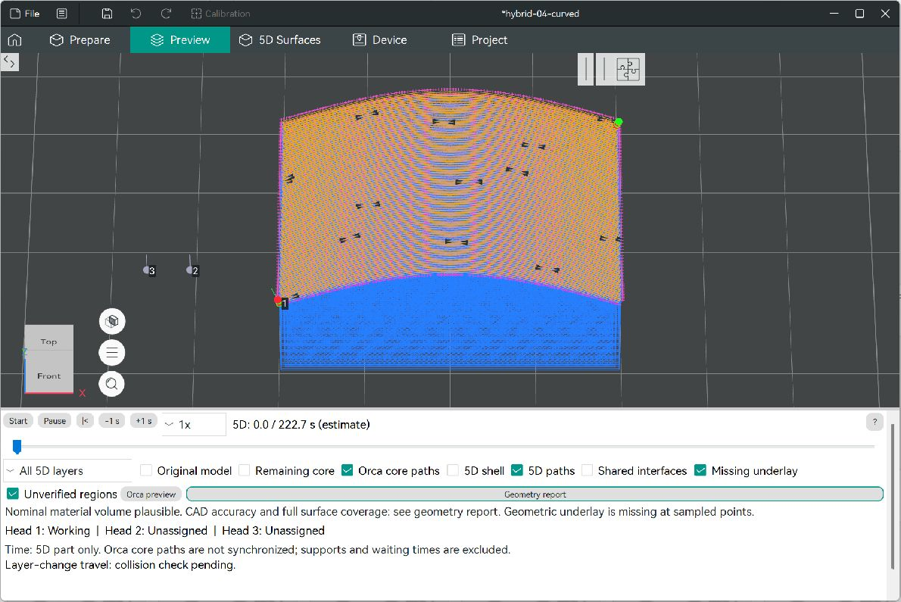
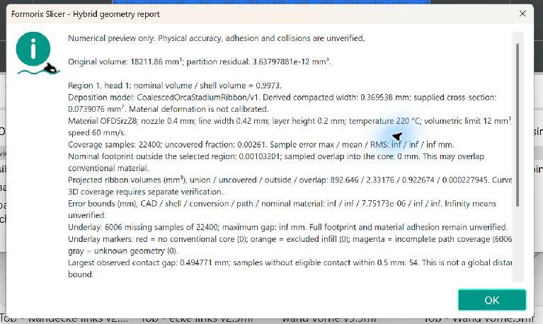
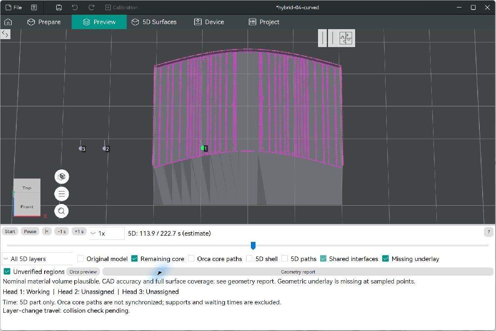
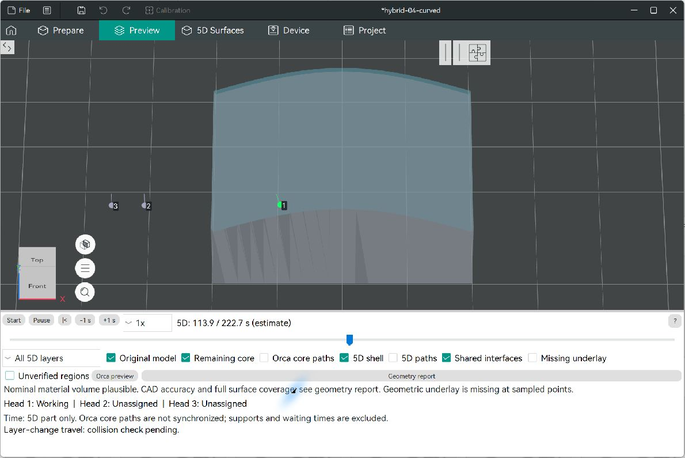
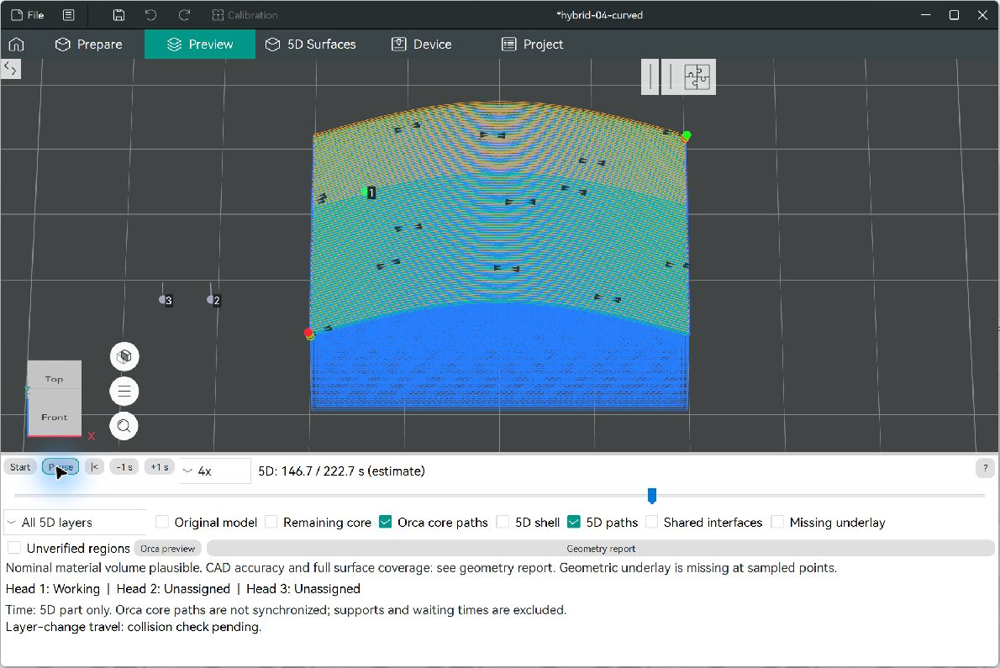
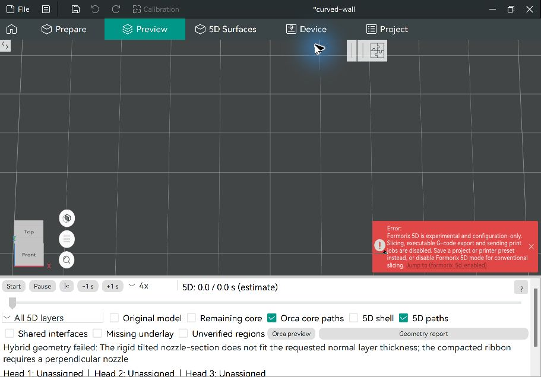
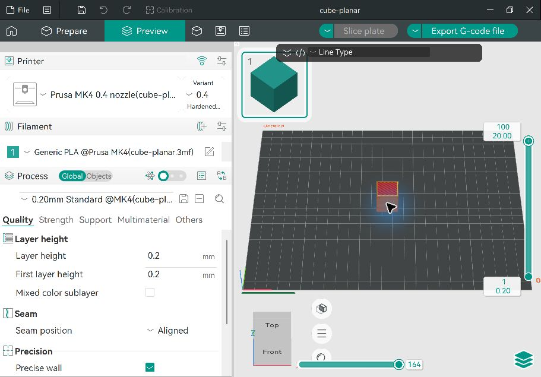

# Native Windows-GUI-Prüfung – Auftrag 04 Nachtrag

Datum: 11. November 2026. Tatsächlich bedient wurde der installierte Windows-Release-Build aus C++-Quellstand `2d5db079508df40f68a20de83942221bb8a67524`, siehe [Buildmanifest](build-manifest.txt). Die Bilder sind unveränderte native Fensteraufnahmen. Alle Berechnungen bleiben experimentelle interne Vorschauen.

## Hybrid-Berechnung und Diagnose

Das gespeicherte Wölbungsprojekt wurde geöffnet und über **Calculate hybrid preview** berechnet. Die Vorschau zeigt normale Orca-Kernbahnen und nichtplanare 5D-Bahnen gemeinsam. Die Gesamtdauer **222,7 s** ist ausdrücklich nur der geplante 5D-Teil; Kernbahnen sind nicht synchronisiert, Supports und Wartezeiten fehlen. Verfahrbewegungen zwischen Lagen tragen den Hinweis auf ausstehende Kollisionsprüfung.

Der Geometriebericht zeigt den nominalen Materialvolumenfaktor gerundet als **0,9973** (automatisierter Rohwert: 0,9973219898), eine kompaktierte Breite von **0,369538 mm** und einen zugeführten Querschnitt von **0,0739076 mm²**. Das Profil selbst behält Breite 0,42 mm, Höhe 0,2 mm und Flow 0,98. Projektionslücken und fehlende Hüllenproben verhindern weiterhin die pauschale 0,01-mm-Bestätigung. [Berichtstext](gui-report.txt), [unterer Berichtsteil](gui-report-bottom.png), [früherer Bericht mit Faktor 4,64](before-report.png).

Alle acht Sichtbarkeitsgruppen wurden ein- und ausgeschaltet: Original, Kern, Orca-Kernbahnen, Schale, 5D-Bahnen, gemeinsame Grenzflächen, fehlende Auflage und ungeprüfte Bereiche. Die Auflagediagnose zeigt **6.006 / 22.400** fehlende Proben als Magenta-Punkte: Kern vorhanden, nominaler Bahnkontakt unvollständig. Fehlender Kern, ausgeschlossene Füllung und unbekannte Geometrie zählen für dieses Projekt jeweils 0. Der Bericht nennt den maximal gefundenen Abstand von 0,494771 mm sowie 54 Proben ohne geeigneten Kontakt innerhalb von 0,5 mm. Das ist kein Tragfähigkeitsnachweis.

## Zeitsteuerung und Hilfe

| Tatsächliche Bedienung | Beobachtung / Beleg |
| --- | --- |
| Horizontalen Schieber ziehen | Position **113,9 s**, Düsenmarkierung folgt der Bahn. [Zustand](gui-slider.txt). |
| **+1 s** drücken | **114,9 s**. [Zustand](gui-plus1.txt). |
| **−1 s** drücken | Wieder **113,9 s**. [Zustand](gui-minus1.txt). |
| Geschwindigkeit **4×**, Start, Pause | Zeit läuft weiter und hält bei **146,7 s**; Kopf 1 arbeitet, Köpfe 2/3 sind nicht zugeordnet. [Zustand](gui-pause.txt). |
| **\|<** drücken | Zeit springt auf **0,0 s** zurück. |
| **?** bei der Zeitsteuerung | Browser öffnet `docs/formorix/preview.md` am unveränderlichen Commit `0e7bba2d317ec671bcf75ad6944cee795ccab359`. Zusätzlicher vollständiger [Link-/Anker-Audit](help-links.json). |

## Projekt-Roundtrip und Sperren

Das Projekt wurde als [hybrid-verified.3mf](hybrid-verified.3mf) gespeichert und über den Öffnen-Dialog erneut geladen. Markierter Bereich **Wölbung**, vier Lagen und 0,2 mm Lagenhöhe bleiben erhalten. Die erneute Hybridberechnung ergibt wieder 222,7 s und denselben Status zur nominalen Menge und fehlenden Auflage. [Roundtrip-Zustand](gui-roundtrip.txt).

**Orca preview** führt zurück zur nativen Oberfläche. Beim experimentellen Formorix-Projekt bleiben reguläres Slicing und ausführbarer Export deaktiviert. [GUI-Sperrstatus](gui-export-block.txt). Es wurde keine experimentelle Druckdatei exportiert oder gesendet.

## Ungeeignete Düsenneigung und Rückkehr zum normalen Slicing

Das ursprüngliche Zweiregionenprojekt `curved-wall.3mf` wurde als separate [Prüfkopie](tilt-rejected.3mf) geladen. Die geometrische Teilung ist in den automatisierten Tests gültig, die starre gekippte Materialform passt jedoch nicht in die verlangte normale Lagenhöhe. **Calculate hybrid preview** meldet diese konkrete Einschränkung, statt überlappendes Material als gültig auszugeben. Die Zeitleiste bleibt bei 0, alle drei Köpfe sind nicht zugeordnet. [Zustand](gui-tilt-rejection.txt), [wiederholte Prüfung nach Neustart](gui-restart-tilt.txt).

Danach wurde das vorhandene normale [cube-planar.3mf](../auftrag-04/cube-planar.3mf) geladen und **Slice plate** ausgeführt. Orcas native Vorschau zeigt Wand-/Deckbahnen, **100 Schichten bei 20 mm**, eine native Gesamtschätzung von 20 min 4 s und wieder verfügbaren normalen G-Code-Export. Nach dem Ausblenden der Legende und des G-Code-Textfensters sind die berechneten Bahnen sichtbar. [GUI-Zustand](gui-normal-after-hybrid-rejection.txt).

## Einmaliger Darstellungsfehler im Testaufbau

In der ersten isolierten Testdatensitzung war nach einer durch die Testvorbereitung beschädigten/leeren Konfigurationsdatei die native Vorschau einmal leer, obwohl Orca gültigen G-Code mit 100 Lagen berechnet hatte. Das Programm erzeugte seine Standardkonfiguration neu. Der genaue Zusammenhang mit dem leeren Viewer ist nicht bewiesen.

Die Sitzung wurde regulär geschlossen und mit derselben, nun gültigen Konfiguration neu gestartet. In diesem frischen Prozess wurden zuerst die Wölbung und danach der normale Würfel erfolgreich berechnet. Anschließend bestanden auch die oben dokumentierte Hybrid-Abweisung und das normale Slicing im selben Prozess. Eine unabhängige Sitzung mit bereits gültiger deutscher Konfiguration zeigte ebenfalls korrekte normale Bahnen: [Gegenprobe](gui-normal-orca-valid-config.png).

Die Logs beider englischer Sitzungen zeigen dieselbe Reihenfolge der Viewer-Initialisierung. Nur der erste Start meldet den Konfigurations-Parsefehler. Ein Formorix-Quellfehler ist damit nicht nachgewiesen; die genaue interne Ursache des einmaligen Leerzustands bleibt offen. Ursprüngliche Konfigurationen und eine wiederhergestellte Sitzung wurden lokal gesichert, nicht verworfen. Eine allgemeine Fehlerfreiheit sämtlicher Orca-GUI-Funktionen wird aus diesen gezielten Regressionen nicht abgeleitet.
