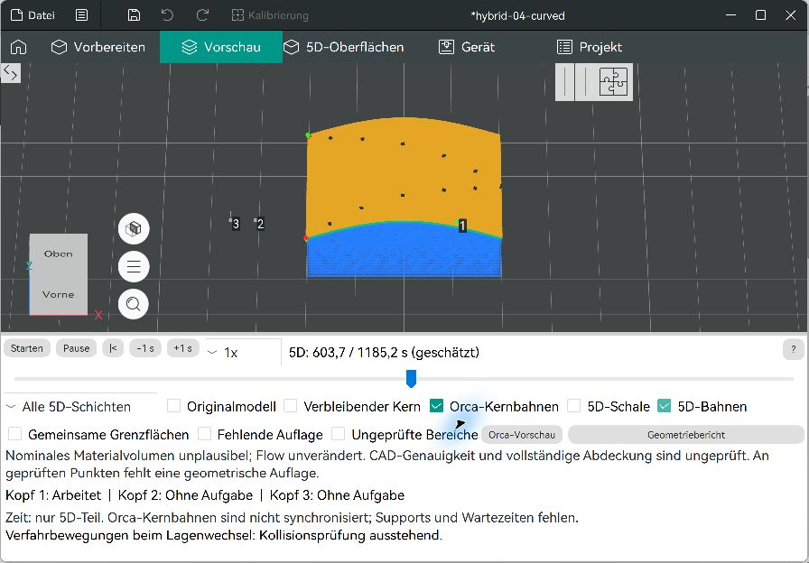
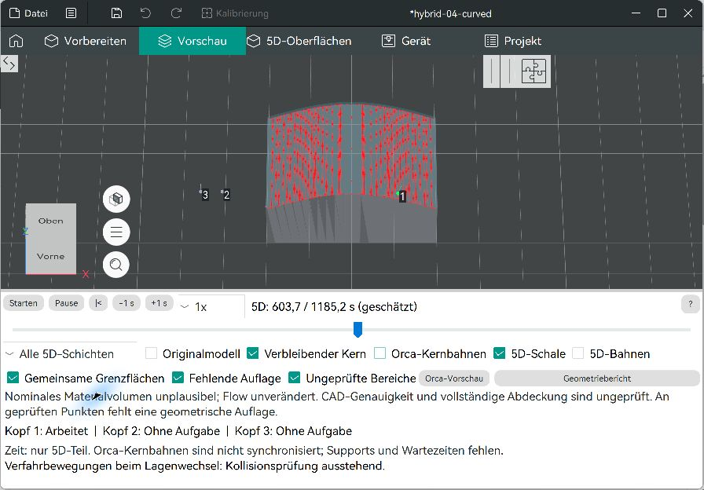
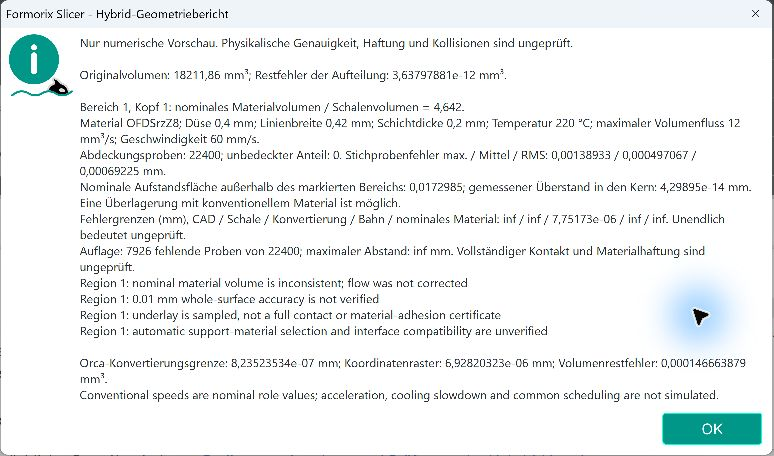
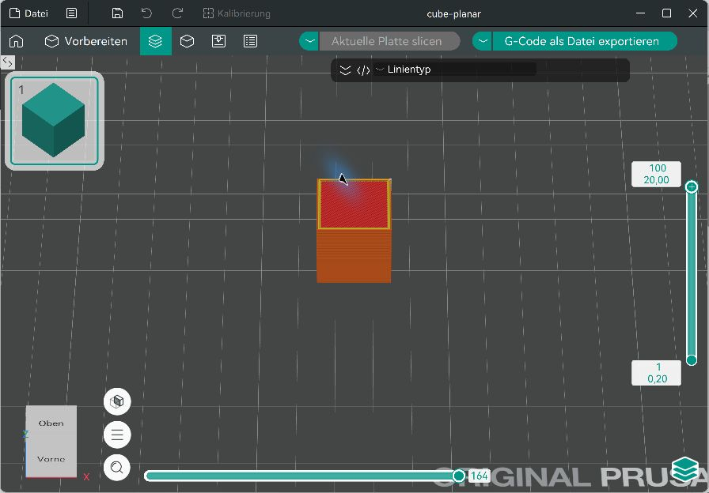

# Windows-GUI-Abnahme des Hybrid-Prototyps

Datum: 11. November 2026. Finaler C++-Stand `8a2159e9f56aa2663dee513b0f303119d4a23d8b`, installierter Release-Build `build/Formorix-Auftrag04`, getrenntes Testdatenverzeichnis `../verification/gui-data-04`. Die folgenden Schritte wurden über die native Windows-GUI ausgeführt.

## Oberfläche und gemeinsame Vorschau

1. Das mitgelieferte `curved-wall.3mf` mit seinen beiden Markierungen geöffnet und die Hybridberechnung gestartet. Die überlappenden Schalen an der gemeinsamen scharfen Grenze wurden ausdrücklich abgewiesen.
2. Die zweite, senkrechte Testregion in einer Projektkopie entfernt. Die Wölbungsmarkierung mit vier Lagen zu 0,2 mm blieb erhalten. Als [hybrid-curved.3mf](hybrid-curved.3mf) gespeichert und wieder geöffnet.
3. **Hybrid-Vorschau berechnen** mit dem tatsächlich zugeordneten Formorix-0,4-mm-Profil ausgeführt. Blaue native Orca-Kernbahnen und goldene 5D-Bahnen erschienen gemeinsam. Das Originalmesh blieb unverändert.
4. Kernbahnen aus- und eingeblendet. Originalmodell, Kern, Schale, Grenzflächen, fehlende Auflage und ungeprüfte Bereiche getrennt geschaltet. Das Abschalten der 5D-Bahnen entfernt auch deren aktive Segmentmarkierung; die kleinen Düsenmarkierungen bleiben erhalten.
5. **Geometriebericht** geöffnet. Tatsächlich angezeigt: 22.400 Oberflächenproben; nominaler Maximalfehler 0,00138933 mm; Volumenfaktor 4,642; 7.926 fehlende Auflageproben; CAD-/Schalen-/Interpolations-/Materialschranken unendlich. Orca-Floatkonvertierung 8,23523534 × 10⁻⁷ mm, Rasterbeitrag 6,92820323 × 10⁻⁶ mm, konvertiertes Volumenresiduum 0,000146663879 mm³. [Beobachteter GUI-Text](gui-report.txt).

## Zeitleiste und Hilfe

- Gesamtdauer des Standardprofil-5D-Teils: 1.185,2 s. Kernbahnen sind statisch; die GUI weist ausdrücklich auf fehlende Synchronisierung und ausgeschlossene Supports/Wartezeiten hin.
- Schieber auf 603,7 s bewegt: Kopf 1 wechselte sichtbar seine Position; Kopf 2 und 3 blieben ohne Aufgabe. Alle drei Düsenbeschriftungen waren sichtbar.
- 4× über die tatsächliche Auswahlliste gewählt, gestartet und bei 675,2 s pausiert. +1 s ergab 676,2 s, −1 s wieder 675,2 s. Die Pausenposition blieb stehen.
- Der Hilfeaufruf öffnete `preview.md` am stabilen Commit `967bbae1da8a5d5cb8a657a37b50aab2ac13ec6b`. Die Seite enthält den Link zur Hybrid-Hilfe.
- Die Zeit-/Sicherheitszeilen sind im finalen Fenster vollständig sichtbar. Der Bedienbereich besitzt zusätzlich vertikales Scrollen für kleinere Fenster.

## Unabhängige Kopfprofile und 3MF-Rundlauf

In **Mehrkopf-Betrieb** Kopf 1 an das vorhandene Orca-Düsenprofil `MyKlipper 0.8 nozzle` und `Generic ABS @Prusa` gebunden, Kopf 2 beim aktuellen Formorix-Profil belassen, Kopf 3 an `MyKlipper 0.6 nozzle` gebunden. Das sind reine Orca-Profilquellen; es wurde keine Klipper-Verbindung angelegt oder angesprochen.

Als [hybrid-profiles.3mf](hybrid-profiles.3mf) gespeichert, über den Windows-Dateidialog wieder geöffnet und alle drei Bindungen im Editor kontrolliert. Die neue Hybridberechnung funktionierte und ergab eine veränderte 5D-Dauer von 593,6 s. Nach Speichern wurden die aufgelösten Werte unabhängig aus der 3MF-Datei gelesen:

| Kopf | Düse | Linienbreite | Temperatur | Flow |
| --- | --- | --- | --- | --- |
| 1 | 0,8 mm | 0,84 mm | 260 °C | 0,93 |
| 2 | 0,4 mm | 0,42 mm | 220 °C | 0,98 |
| 3 | 0,6 mm | 0,63 mm | 220 °C | 0,98 |

[Gespeicherte Kopfprofile](gui-head-profiles.json). Nur Kopf 1 hatte eine zugewiesene Oberflächenbahn. Es wurde kein paralleler Ablauf simuliert. Die automatische Invalidierung nach Inhaltsänderungen eines Orca-Presets unter gleichem Namen wurde zusätzlich automatisiert geprüft; der GUI-Rundlauf prüfte die tatsächlichen Bindungsänderungen und ihre Neuauflösung.

## Normales Orca-Slicing und Drucksperre

Über **Orca-Vorschau** zur normalen Ansicht gewechselt. Beim Formorix-Projekt blieben ausführbares Slicing/Export gesperrt. Anschließend [cube-planar.3mf](cube-planar.3mf) mit dem vorhandenen Prusa-MK4-Profil geöffnet und **Aktuelle Platte slicen** ausgeführt: erfolgreich, 100 Schichten bis Z = 20 mm, normale Wände, Infill und obere/untere Strukturen. Die normale Exportfunktion war aktiv; es wurde kein experimenteller Druckauftrag exportiert.

Die Tests betreffen die geänderten Windows-Abläufe. Sie sind keine vollständige Prüfung sämtlicher Orca-Dialoge, anderer Betriebssysteme oder realer Druckhardware.
